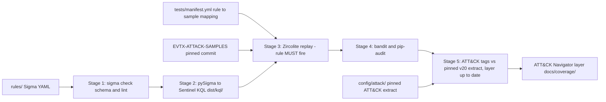

# detection-factory

[](https://github.com/mbart75/detection-factory/actions/workflows/ci.yml) [](https://github.com/mbart75/detection-factory/releases/latest) [](https://attack.mitre.org/) [](LICENSE)

Detection-as-Code pipeline: Sigma rules, validated in CI against real attack logs,
converted to Microsoft Sentinel KQL, mapped to MITRE ATT&CK.

## Why

Anyone can write a detection rule. The hard question is: **how do you know it fires?**
This repo answers it with engineering discipline: every rule is (1) schema-validated,
(2) converted to the target backend, (3) replayed against a real EVTX attack sample
and required to trigger, and (4) checked against a pinned ATT&CK release before it
reaches the coverage map. The pipeline's own Python tooling is scanned with Bandit,
and its pinned dependencies with pip-audit. All of it runs in CI on every pull
request, and `main` only accepts a change once CI passes.

## Architecture



## Coverage

9 rules across 7 ATT&CK tactics (ATT&CK v20). Load `docs/coverage/layer.json` in the
[ATT&CK Navigator](https://mitre-attack.github.io/attack-navigator/) to see it.

| Rule | Technique | Tactic |
|---|---|---|
| LSASS memory dump via comsvcs MiniDump | T1003.001 | Credential Access |
| PowerShell engine loaded by unusual host | T1059.001 | Execution |
| Scheduled task created via schtasks | T1053.005 | Persistence / Execution |
| Registry Run key modification | T1547.001 | Persistence |
| UAC bypass via eventvwr mscfile hijack | T1548.002 | Privilege Escalation |
| Rundll32 proxy execution | T1218.011 | Stealth |
| Netsh port proxy persistence | T1090.001 | Command and Control |
| Security event log cleared (1102) | T1685.005 | Defense Impairment |
| Shell spawned by WmiPrvSE | T1047 | Execution |

## Test data - honest note

v1 rules are validated against community reference EVTX from
[sbousseaden/EVTX-ATTACK-SAMPLES](https://github.com/sbousseaden/EVTX-ATTACK-SAMPLES),
pinned to commit `4ceed2f` and downloaded at test time (never redistributed here).
v2 will regenerate these logs by executing the matching
[Atomic Red Team](https://github.com/redcanaryco/atomic-red-team) tests in a home lab.
No real client or employer data exists anywhere in this repository.

## Quickstart

```bash
python3 -m venv .venv && source .venv/bin/activate
pip install --require-hashes -r requirements.txt   # locked, hash-checked
bash scripts/setup_zircolite.sh                    # Zircolite at a pinned commit
python3 tests/runner/fetch_samples.py
python3 tests/runner/run_tests.py      # every rule must fire
python3 scripts/convert_rules.py       # KQL output in dist/kql/
python3 scripts/build_layer.py         # ATT&CK tag checks + Navigator layer
```

## Repository layout

```
rules/          Sigma rules, one directory per ATT&CK tactic
config/         validation config, pinned ATT&CK extract, Sentinel SecurityEvent table setting
                (field mapping comes from pySigma's built-in pipelines)
tests/          manifest (rule -> sample -> expected hits) + Zircolite runner
scripts/        KQL conversion, ATT&CK layer generation, ATT&CK extract update
docs/           coverage layer, design decisions
.github/        CI pipeline, Dependabot
```

## Design decisions and trade-offs

See [docs/decisions.md](docs/decisions.md).

## License

Code is under the [MIT License](LICENSE). The Sigma rules in `rules/` are under the
[Detection Rule License 1.1](rules/LICENSE.Detection.Rules.md), the licence used by
SigmaHQ: reuse them freely, but keep the author and the licence when you share
them or report their matches. Security issues: see [SECURITY.md](SECURITY.md).
